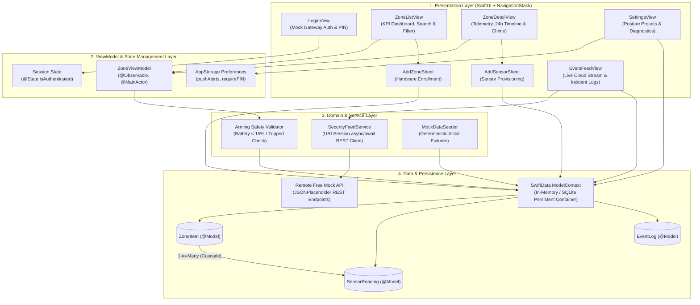
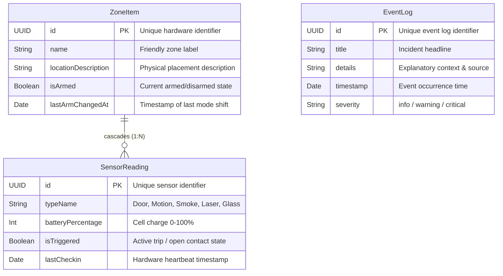
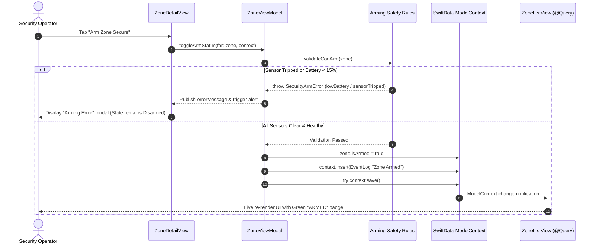
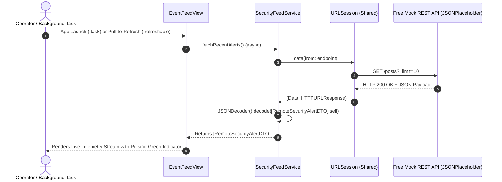

# Architecture Note: SecureNest Companion App

**Document Version**: 2.0  
**Target Platform**: iOS 17.0+ / macOS 14.0+  
**Architecture Pattern**: Layered MVVM + Repository/Service Pattern + Native SwiftData  
**Persistence Engine**: Apple SwiftData (Native, Zero Third-Party Dependencies)  
**Concurrency Engine**: Modern Swift Concurrency (`async/await`, Structured Tasks, `@MainActor`)  

---

## 1. Executive Summary & Architectural Intent

**SecureNest** is a native companion application designed for physical security monitoring, zone surveillance, and hardware telemetry telemetry ingestion. The system provides real-time situational awareness across monitored perimeter zones, enforces strict hardware arming safety rules, streams remote cloud telemetry over modern asynchronous pipelines, and maintains an offline-first persistent store.

### Core Architectural Goals
1. **Safety-Critical Business Invariants**: Arming logic must prevent arming compromised zones (e.g., active intrusions or critically depleted sensor batteries).
2. **Offline-First Resilience**: All zones, sensor telemetry, and incident audit logs are persisted locally using native **SwiftData**, guaranteeing complete functional autonomy without network connectivity.
3. **Asynchronous Telemetry Ingestion**: Remote live feeds consume REST APIs using modern Swift Concurrency (`async/await`) decoupled from the UI thread.
4. **Declarative Unidirectional Data Flow**: Seamless state synchronization from SwiftData models to SwiftUI views via `@Observable` view models and `@Query` property wrappers.
5. **Multiplatform Parity**: Complete cross-platform execution on iOS, iPadOS, and macOS with platform-adaptive controls.

---

## 2. High-Level System Architecture

The application is structured into four distinct layers following the **Model-View-ViewModel (MVVM)** and **Service / Repository** architectural patterns:



---

## 3. Data Schema & Entity Relationship Architecture

Persistence is powered by Apple's native **SwiftData** framework, operating on a unified relational object graph:



### Key Schema Characteristics
- **Cascade Deletion**: When a `ZoneItem` is deleted, its child `SensorReading` entities are automatically purged via `@Relationship(deleteRule: .cascade)` to maintain relational integrity.
- **Explicit Identifiable & Hashable Conformance**: Implements deterministic `==` and `hash(into:)` based on `id: UUID`, ensuring flawless SwiftUI collection diffing and navigation routing.
- **Computed Telemetry Properties**: Domain models encapsulate computed UI helpers (`primaryIcon`, `batteryIcon`, `batteryColor`, `hasAlert`, `hasLowBattery`) keeping views declarative and logic-free.

---

## 4. State Management & Unidirectional Data Flow

The application enforces a unidirectional data flow (UDF) pipeline:



### State Lifecycle Layers
1. **Ephemeral View State (`@State`, `@FocusState`)**: Manages view-local concerns such as sheet presentation, password visibility, search filters, and audio chime timers.
2. **Observable Business Logic (`@Observable ZoneViewModel`)**: Handles arm/disarm command dispatching, safety validation, and transient error signaling without Combine overhead.
3. **Persistent Global Graph (`@Query`, `@Environment(\.modelContext)`)**: Automatically synchronizes views with the underlying SQLite store whenever changes commit.
4. **App Session State (`@AppStorage`, `@Binding`)**: Tracks persistent user preferences (push notification settings, master PIN requirements) and authentication tokens across app launches.

---

## 5. Domain Business Logic & Safety Rules

The security companion app enforces strict domain invariants during arming operations:

### Arming Safety Matrix

| Current State | Battery Level | Sensor Contact State | Action Attempted | Result | Triggered Error / Side-Effect |
| :---: | :---: | :---: | :---: | :---: | :--- |
| **Disarmed** | $\ge 15\%$ | Clear / Closed | Arm Zone | **Success** | `zone.isArmed = true`, `EventLog(info)` created |
| **Disarmed** | $< 15\%$ | Clear / Closed | Arm Zone | **BLOCKED** | `SecurityArmError.lowBattery`, modal alert displayed |
| **Disarmed** | $\ge 15\%$ | Tripped / Open | Arm Zone | **BLOCKED** | `SecurityArmError.sensorTripped`, modal alert displayed |
| **Disarmed** | $< 15\%$ | Tripped / Open | Arm Zone | **BLOCKED** | First failing sensor aborts transaction |
| **Armed** | Any | Any | Disarm Zone | **Success** | `zone.isArmed = false`, `EventLog(warning)` created |

> [!IMPORTANT]
> **Safety Invariant**: Disarming a zone is never restricted by sensor health or battery status. Failsafe disarming ensures an operator can always silence or neutralize an active zone.

---

## 6. Asynchronous Telemetry & Networking Architecture

Remote telemetry streaming is decoupled from the user interface using modern **Swift Concurrency**:



### Networking Best Practices Implemented
- **Structured Concurrency**: Network invocations are bound to SwiftUI view lifecycles via `.task` and `.refreshable`, guaranteeing automatic cooperative task cancellation when navigating away.
- **HTTP Validation**: Explicitly verifies `200...299` HTTP status codes before invoking `JSONDecoder`.
- **Zero Third-Party Dependencies**: Built on standard `Foundation.URLSession`, requiring no CocoaPods, SPM packages, or external SDK overhead.

---

## 7. Presentation Layer & UI Architecture

The UI adheres strictly to human interface guidelines (HIG) while delivering a purpose-built cybersecurity aesthetic:

```
SecureNest Navigation & View Hierarchy
│
├── LoginView (Root Gateway when unauthenticated)
│   ├── Ambient Background Glow Spheres (Blur 80pt)
│   ├── Hero Shield Container (88x88pt Linear Gradient)
│   ├── PIN Input with Show/Hide Password Toggle
│   ├── Evaluation Shortcut (Auto-fill Demo PIN 4829)
│   └── Gateway Security Footer (Online • AES-256 • SwiftData)
│
└── Main TabView (Presented upon authentication, Tint: Theme.cyberBlue)
    │
    ├── Tab 1: ZoneListView (NavigationStack)
    │   ├── Toolbar: Principal Shield Branding & "+ Add Zone" Primary Action
    │   ├── SystemStatusBanner (Dynamic System-Wide Health State)
    │   ├── QuickMetricsRow (4-Pillar KPI Tiles: Armed, Disarmed, Alerts, Low Bat)
    │   ├── FilterBar (All / Armed / Disarmed / Alerts)
    │   ├── Live SearchBar (Instant name & location filtering)
    │   ├── ForEach(ZoneItem) -> Custom Zone Cards with Quick Arm Button
    │   │   └── ContextMenu: Quick Arm/Disarm, Delete Zone
    │   └── Sheet: AddZoneSheet (Custom Hardware Enrollment)
    │       └── Navigates to -> ZoneDetailView (via .navigationDestination)
    │           ├── HeroStatusSection (80x80 Double-Ring Badge + Status Capsule)
    │           ├── ArmingControlsSection (Arm/Disarm Toggle with Error Alerts)
    │           ├── SensorsSection (Hardware Telemetry, Battery Gauges)
    │           │   └── Interactive Evaluator Simulators: "Simulate Trip" & "Drop Battery <15%"
    │           ├── TelemetryTimelineSection (Visual 24h Hourly Gradient Bar Chart)
    │           ├── HardwareDiagnosticsSection (Ping Zone Latency & 85dB Chime Test)
    │           └── Sheet: AddSensorSheet (Enroll additional sensors to zone)
    │
    ├── Tab 2: EventFeedView (NavigationStack)
    │   ├── Toolbar: Export Audit Log (ShareLink) & Clear Logs
    │   ├── CriticalAlertBanner (Sticky glowing alert when tripped zones exist)
    │   ├── LiveHeaderCard (Animated Pulsing Live Dot + REST Gateway info)
    │   ├── FilterBar (All / Live Cloud / Hardware Logs)
    │   ├── Live Cloud Stream Section (Decoded RemoteSecurityAlertDTOs via async/await)
    │   └── Local Hardware Incident Section (SwiftData EventLogs with severity badges)
    │
    └── Tab 3: SettingsView (NavigationStack)
        ├── SecOps Supervisor Profile Card (Admin Privileges)
        ├── SecurityPostureCard (Presets: Balanced, Lockdown, Night Guard)
        ├── PreferencesCard (Push Notifications & PIN enforcement toggles)
        ├── DataManagementCard (Live SwiftData Metrics, Reset Sample Data, Clear Logs)
        ├── AboutCard & Export Diagnostics (ShareLink system diagnostic report)
        └── SignOutButton (Destructive session logout returning to LoginView)
```

---

## 8. Automated Testing Strategy (XCTest)

The project includes an isolated, reproducible automated test suite located in `SecureNestTests/ZoneLogicTests.swift`.

### Test Architecture Highlights
- **In-Memory Store Isolation**: The test harness provisions a fresh `ModelContainer` configured with `isStoredInMemoryOnly: true` in `setUpWithError()`:
  ```swift
  let config = ModelConfiguration(isStoredInMemoryOnly: true)
  container = try ModelContainer(for: ZoneItem.self, SensorReading.self, EventLog.self, configurations: config)
  context = container.mainContext
  viewModel = ZoneViewModel()
  ```
  This guarantees test runs produce zero filesystem side-effects and run hermetically in parallel.
- **Teardown Cleanup**: All references (`viewModel`, `container`, `context`) are explicitly nulled in `tearDownWithError()`.

### Test Suite Coverage

| Test Method | Scenario Evaluated | Expected Outcome |
| :--- | :--- | :--- |
| `testArmZone_Success` | Zone with healthy sensors ($\ge 15\%$ battery, clear contact) | `zone.isArmed == true`, `errorMessage == nil` |
| `testArmZone_FailsOnLowBattery` | Zone with a sensor exhibiting $10\%$ battery ($< 15\%$) | `zone.isArmed == false`, `errorMessage != nil` |
| `testArmZone_FailsWhenTripped` | Zone with an actively triggered sensor (`isTriggered == true`) | `zone.isArmed == false`, `errorMessage != nil` |
| `testDisarmZone_AlwaysSucceeds` | Previously armed zone receiving a disarm request | `zone.isArmed == false`, `errorMessage == nil` |

---

## 9. Architectural Trade-offs & Decisions

| Decision | Chosen Approach | Alternative Considered | Rationale |
| :--- | :--- | :--- | :--- |
| **Persistence** | **SwiftData** (`@Model`) | Core Data (`.xcdatamodeld`) | Native Swift-first modeling, zero XML/model compiler friction, seamless SwiftUI `@Query` reactivity. |
| **Observation** | **SwiftUI `@Observable`** | Combine `ObservableObject` | Lower memory footprint, fine-grained property-level view invalidation, no manual `AnyCancellable` subscription leaks. |
| **Concurrency** | **Structured `async/await`** | Completion Handlers / GCD | Prevents callback hell, provides compiler-enforced thread safety, automatic task cancellation with view lifecycle. |
| **UI Navigation** | **`NavigationStack` Destinations** | Legacy `NavigationView` | Type-safe value-driven routing (`.navigationDestination(for:)`), programmatic backstack control. |
| **Dependency Injection** | **Environment `\.modelContext`** | Global Singletons | Facilitates clean unit testing using in-memory mock containers without monkey-patching globals. |
